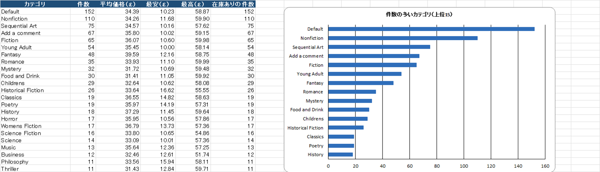
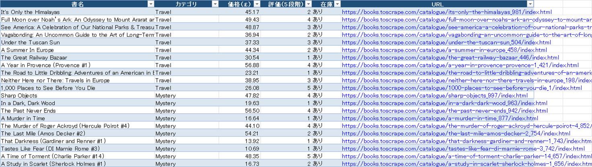
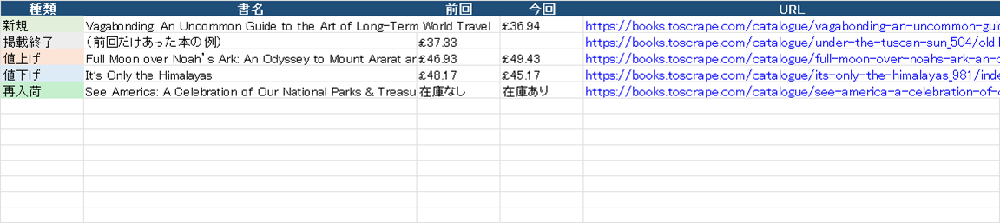

# Webデータ収集・Excelレポート ツール（web-collect-report）

Webサイトの商品一覧を毎回同じ手順で集めて、ExcelのレポートにまとめるPythonのツールです。
「毎朝サイトを開いて価格や在庫をコピペし、前の日と見比べる」作業を、自動で回すことを想定して作りました。

集める先には、データ収集の練習用に公開されている架空の書店 [books.toscrape.com](https://books.toscrape.com/)（1,000冊・50カテゴリ）を使っています。クライアント案件ではなく、作り方と品質を見ていただくためのサンプルです。



## できること

- カテゴリをたどって、全ページの商品（書名・カテゴリ・価格・評価・在庫）を集める
- 設定すれば、詳細ページから在庫数と商品コードも取る
- 結果をExcelにまとめる（概要・一覧・カテゴリ別・評価別・前回との差分）
- 毎回の結果をCSVで残し、前回と比べて「新規・掲載終了・値上げ・値下げ・在庫切れ・再入荷」を出す
- 終わったらSlack・Teams・Discordに知らせる（WebhookのURLを書いたときだけ）
- Pythonが入っていないPCでも動くexeを作れる

### 出力するレポート

| シート | 内容 |
|---|---|
| 概要 | 取得日時、件数、平均価格、前回からの変化の件数 |
| 一覧 | 全件（フィルター付き。URLはクリックで開ける） |
| カテゴリ別 | 件数・平均・最安・最高価格と、件数の多いカテゴリの棒グラフ |
| 評価別 | 星の数ごとの件数と平均価格、棒グラフ |
| 前回との差分 | 変わった商品の一覧。種類ごとに色分け |



2回目からは「前回との差分」シートに変化が出ます。下の画像は見え方の例です（練習用サイトは中身が変わらないので、前回分のCSVを書き換えて再現しています。`tools/demo_diff.py`）。



## 使い方（ツールを使う人向け）

1. `dist\webcollect` フォルダ（`webcollect.exe`・`config.yaml`・`使い方.txt`）を好きな場所に置く
2. `webcollect.exe` をダブルクリックする（全カテゴリで1分半ほど）
3. `output` フォルダに `report_日付_時刻.xlsx` ができる

毎日決まった時間に動かすときは、Windowsの「タスク スケジューラ」に `webcollect.exe` を登録します。手順は `使い方.txt` に書いてあります。

### 設定（config.yaml）

| 項目 | 内容 | 初期値 |
|---|---|---|
| `categories` | 集めるカテゴリ。空なら全部（例: `[Mystery, Travel]`） | `[]` |
| `delay_seconds` | 1回取りに行くごとに待つ秒数。0.5未満はエラーにする | `1.0` |
| `timeout_seconds` / `max_retries` | 待つ上限と、失敗したときのやり直し回数 | `15` / `3` |
| `fetch_details` | 詳細ページ（在庫数・商品コード）も取るか | `false` |
| `output_dir` / `log_dir` | 結果とログを置くフォルダ | `output` / `logs` |
| `webhook_url` | 終わったときの通知先。空なら通知しない | 空 |

書き間違い（知らない項目名、間隔が短すぎる、URLの形がおかしい など）は、動かす前に止めて何が違うかを表示します。

## 使い方（開発する人向け）

```bash
python -m venv .venv
.venv\Scripts\pip install -r requirements.txt -r requirements-dev.txt
copy config.example.yaml config.yaml
set PYTHONPATH=src
.venv\Scripts\python -m webcollect                      # config.yaml のとおりに集める
.venv\Scripts\python -m webcollect --categories Travel --details --no-notify
.venv\Scripts\python -m pytest                          # テスト（31件）
powershell -ExecutionPolicy Bypass -File build_exe.ps1  # exe を dist\webcollect に作る
```

終了コードは、正常が0、取得や読み取りの失敗が1、設定ファイルの誤りが2です。タスク スケジューラなどから失敗を見分けられます。

## 作りで気をつけたこと

相手のサーバーに迷惑をかけないことを一番に考えました。最初にrobots.txtを読み、禁止されたページは取りに行きません。robots.txtが401・403で読めないときも「禁止」として扱います。リクエストの間は必ず1秒あけ、User-Agentにはツール名と連絡先（このリポジトリ）を入れています。

- 429や500番台のエラーは、間隔を広げながら最大3回やり直します。一時的な混雑では止まりません
- サイトの形が変わって項目が見つからないときは、空のデータを黙って出さずに止めます。どのページで何が足りないかはログに書きます
- 価格はDecimalで持っています。小数の誤差で、ありもしない「値上げ」「値下げ」が出ないようにするためです
- 1冊が複数のカテゴリに出ても、URLで重複を除いて1件に数えます
- ログは `logs\webcollect.log` に残します（1MBごとに切り替え、5世代まで）。履歴のCSVは、Excelでそのまま開けるようBOM付きUTF-8にしました

## テスト

`pytest` で31件。保存した本物のページ（`tests/fixtures`）を使い、ネットにつながずに動きます。

- ページの読み取り（カテゴリ50件、2ページ目への移動、最後のページ、詳細ページの在庫数、形が崩れたページ）
- 前回との差分（7種類すべて、変化なし、並び順）
- robots.txt（禁止・なし・403）と、リクエストの間隔
- Excelの中身（シート名、件数、グラフの有無、初回・変化なし・変化ありの表示）
- 設定ファイルの誤り、2回続けて動かしたときの差分の出方、通知が失敗しても止まらないこと

## 構成

```
src/webcollect/
  cli.py        コマンドの入口（引数・ログ・全体の流れ）
  config.py     設定ファイルの読み込みと検証
  fetcher.py    ページの取得（robots.txt・間隔・再試行）
  parser.py     ページから項目を取り出す
  collector.py  カテゴリと全ページをたどる
  storage.py    履歴（CSV）の保存と読み出し
  diff.py       前回との差分
  report.py     Excel レポート
  notify.py     Webhook での通知
tests/          テストと、保存したページ
tools/          README 用の画像づくり（差分の見本、Excel のシートを画像にする）
```

## 使った技術

Python 3.12、requests、Beautiful Soup 4、openpyxl、PyYAML、pytest、PyInstaller

## 実際のサイトに使うときの注意

このツールは練習用サイトに合わせて作っています。ほかのサイトから集めるときは、そのサイトの利用規約とrobots.txtを確認し、許可されている範囲で、間隔をあけて使ってください。読み取りの部分（`parser.py`）はサイトごとに作り直しが必要です。

## ライセンス

MIT License
